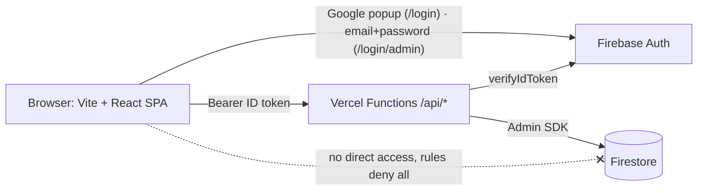

# OX Game — Plan

Spec: [spec.md](spec.md) · Mockups: [mockups/index.md](mockups/index.md)
Branch: `development` (PR → `main`). Commits: Conventional Commits, 1 task = 1 commit.

## System design

### Architecture



- The SPA uses the Firebase Web SDK **for auth only**. All game/score reads and writes go through `/api/*`, which verify the Firebase ID token with the Admin SDK and use Firestore through the Admin SDK. Firestore rules deny all client access (AC-21).
- Game rules, bot and scoring are pure TypeScript in `shared/` (no Firebase imports), used by the API and unit tested.
- Same-origin deploy on Vercel (no CORS). Local dev with `vercel dev`.

### Folder layout

```
api/                     Vercel functions (thin handlers)
  me.ts  leaderboard.ts
  game/current.ts  game/start.ts  game/move.ts
  admin/players.ts
server/                  server-only code (not exposed as routes)
  firebaseAdmin.ts  auth.ts  config.ts  http.ts
  userRepo.ts  gameRepo.ts  gameService.ts
shared/                  pure logic + types shared by api and src
  types.ts  board.ts  bot.ts  scoring.ts
src/                     Vite SPA
  main.tsx  App.tsx  routes.tsx
  auth/  (firebase.ts, AuthContext.tsx, RequireAuth.tsx, RequireAdmin.tsx, e2eAuth.ts)
  api/   (client.ts)
  features/game/  features/leaderboard/  features/admin/  features/login/
  components/ (Layout, Header, Board, ...)
  styles/
e2e/                     Playwright
firestore.rules
vercel.json              SPA rewrite (non-/api → index.html)
.env.example  README.md
```

### API contract

All responses JSON. Errors: `{ "error": { "code": string, "message": string } }`. Auth: `Authorization: Bearer <Firebase ID token>`; 401 on missing/invalid.

| Method + path | Auth | Request | Response |
|---|---|---|---|
| GET `/api/me` | user | – | `{ profile: Profile \| null, isAdmin: boolean }` — player: creates profile on first call; admin (`adminox@gmail.com`): `profile: null`, no `users/{uid}` doc created |
| GET `/api/game/current` | user | – | `{ game: Game \| null }` |
| POST `/api/game/start` | user | `{ difficulty: "easy"\|"hard" }` | `201 { game }`; `409 GAME_IN_PROGRESS` if an unfinished game exists |
| POST `/api/game/move` | user | `{ gameId, cell: 0..8 }` | `{ game, profile }` — game includes bot reply; when finished includes `result`, `scoreDelta`, `bonus` |
| POST `/api/game/abandon` | user | `{ gameId }` | `{ game }` — counts as a **loss** (−1, streak reset) so abandoning can't dodge losses |
| `/api/game/*` (all four above) | user | – | admin accounts get `403 ADMIN_ACCOUNT` (admins are not players) |
| GET `/api/leaderboard` | user | – | `{ players: [{ rank, displayName, photoURL, score, wins, losses, draws }] }` (no email), limit 100 |
| GET `/api/admin/players` | admin | – | `{ players: [{ uid, displayName, email, score, streak, wins, losses, draws, lastPlayedAt }] }`; 403 if not admin |

Types: `Game = { id, difficulty, board: ("X"|"O"|null)[9], status: "in_progress"|"won"|"lost"|"draw", result?: {scoreDelta, bonus} }`, `Profile = { displayName, photoURL, score, streak, wins, losses, draws }`. Defined once in `shared/types.ts`.

### Firestore model

- `users/{uid}`: `displayName, email, photoURL, score, streak, wins, losses, draws, createdAt, lastPlayedAt`
- `games/{gameId}`: `uid, difficulty, board[9], status, createdAt, updatedAt, finishedAt?, scoreDelta?, bonus?`; at most one `in_progress` per user (checked in a transaction). Lookup by `uid` + `status` (single-field indexes are enough; no composite index needed if filtered by `uid` and checked in code).
- `config/bot`: `hardMistakeRate` (number 0..1; default 0.2 when missing or invalid). Edited in Firebase console.
- Leaderboard query: `users` orderBy `score` desc, limit 100; keep players with wins+losses+draws > 0; tie-break by wins and name done in code (avoids composite index). Admin endpoint returns all players.

### Game / scoring rules (server)

- `move` runs in one Firestore transaction: load game → verify owner, status `in_progress`, cell valid and empty → apply X → if not over, bot moves O → if over, compute result and update `users` (score, streak, W/L/D, lastPlayedAt) and set game status. Because the status flips inside the transaction, a repeated request is rejected (AC-16).
- `scoring.apply(stats, result)`: win → streak+1; if new streak = 3 → delta +2, streak 0, else +1. Loss → −1, streak 0. Draw → 0, streak 0.
- Bot easy: random; with a fixed probability (`EASY_SMART_RATE = 0.25`) plays an immediate win/block if available. Bot hard: with probability `hardMistakeRate` random move, otherwise minimax. RNG injected for tests.

### Auth and security

- Client: players use `signInWithPopup(GoogleAuthProvider)` on `/login`; admins use `signInWithEmailAndPassword` on `/login/admin` (separate page, no Google button, no sign-up/reset). Both use `onIdTokenChanged`; token attached by `api/client.ts` (`getIdToken()` refreshes automatically).
- Admin login flow: sign in → `GET /api/me` → if `isAdmin` false then `signOut()` and show the same generic "Invalid email or password." as wrong credentials; wrong credentials (`auth/invalid-credential`, `auth/user-not-found`, `auth/wrong-password`, `auth/invalid-email`) all map to one generic message; `auth/too-many-requests` → "Too many attempts. Try again later."; other errors → generic server error.
- Server `auth.ts`: verify ID token via Admin SDK; `isAdmin = decoded.email?.toLowerCase() === ADMIN_EMAIL && decoded.firebase.sign_in_provider === 'password'`, with `ADMIN_EMAIL = 'adminox@gmail.com'` a constant in `shared/constants.ts` (single fixed admin, approver's decision; no env). **Risk:** console-created accounts have `email_verified=false`, so the check does not rely on it; Firebase allows one account per email, so the admin account must exist before the app is public, otherwise someone could register that email first (README step + UAT case).
- Firebase console setup (approver, documented in README): enable Email/Password provider; turn off "Enable create (sign-up)" under Authentication → Settings → User actions if available; Add user `adminox@gmail.com` with a password (do this before deploy).
- Env (server): `FIREBASE_PROJECT_ID`, `FIREBASE_CLIENT_EMAIL`, `FIREBASE_PRIVATE_KEY` (with `\n` handling). Env (client, `VITE_`): `VITE_FIREBASE_API_KEY`, `AUTH_DOMAIN`, `PROJECT_ID`, `APP_ID`. Only `.env.example` is committed.
- Input validation on every handler (difficulty enum, cell integer 0–8, gameId string). Only `POST` for mutations. No PII beyond email/name/photo; email never sent to non-admins.
- README states plainly that Firebase Google sign-in is OAuth 2.0 / OpenID Connect handled by the SDK.

### Frontend

- Routes: `/login` (players, Google), `/login/admin` (admin, email + password), `/` (game), `/leaderboard`, `/admin`; guards `RequireAuth` and `RequireAdmin`.
- Redirects: logged out → `/` and `/leaderboard` go to `/login`, `/admin` goes to `/login/admin`; signed-in admin visiting `/` or `/login/admin` goes to `/admin`; signed-in non-admin at `/admin` sees the not-authorized state. Header for admin: Leaderboard · Admin · Sign out (no Play).
- Files: `src/features/login/` (player) and `src/features/login-admin/` (admin) stay separate components.
- State: React context for auth; local component state + small hooks for API calls (no extra state library).
- Plain CSS with custom properties, mobile first. Reused components: none (new repo).
- E2E auth: `VITE_E2E=true` swaps the Firebase auth module for a fake signed-in user (`auth/e2eAuth.ts`); `/api/*` is mocked with `page.route`. The flag is never set in the production build; the README says so, and the build check in Phase 5 greps that the e2e module is not bundled.

### Technology stack

| Part | Choice | Reason | No-new-dependency alternative |
|---|---|---|---|
| Build / UI | Vite + React 18 + TypeScript | requested (Vite) | – |
| Routing | react-router-dom | standard SPA routing | hand-rolled history routing (more code) |
| Auth (client) | firebase (modular) | Google sign-in via Firebase | – |
| Server | @vercel/node + firebase-admin | token verify + Firestore | – |
| Unit/integration | Vitest + React Testing Library + jsdom | Vite-native | – |
| E2E | Playwright | approved at Gate 0, install needs approval | none |

### Skill mapping

| Part | Stack | Skill | Note |
|---|---|---|---|
| FE scaffold | Vite + React + TS | – (missing) | `skill-nextjs-ts-scaffold` is Next.js-only; scaffold by hand |
| FE unit test | Vitest + RTL | `skill-fe-unit-test` (partial) | written for Jest/Next; follow its coverage and style ideas, but use Vitest APIs |
| BE API | Vercel Functions + Firebase Admin | – (missing) | `skill-nest*` do not apply |
| BE test | Vitest | – (missing) | |
| PR description | – | `skill-pr-review-description` | covers `src/` only; add `api/`, `server/`, `shared/` manually |
| E2E | Playwright | – (missing) | follow rules in the architect brief |

## Tasks

Lead-owned tasks involve approval-required actions (dependencies, config). Parallel tasks never share Files.

| ID | Task | Owner | Files | Skills | Depends on | AC | Status |
|----|------|-------|-------|--------|-----------|----|--------|
| T0 | Initial commit on `main`, create `development`, scaffold Vite React TS, install deps (react-router-dom, firebase, firebase-admin, @vercel/node, vitest, RTL, jsdom), tsconfig, eslint, scripts, `vercel.json`, `.env.example`, `.gitignore` | lead | repo root config files | – | Gate B | AC-24 | done (Vercel smoke unverified) |
| T1 | Pure logic: types, board rules, scoring, bot (easy/hard, injectable rng) | backend-developer | `shared/*.ts` | – | T0 | AC-8,10,11,12-15 | done |
| T2 | Unit tests for shared logic (all lines, scoring table, bot rate 0/1, hard never loses) | test-be-engineer | `shared/__tests__/*` | – | T1 | AC-8,10-15 | done |
| T3 | Server lib: firebaseAdmin, auth (token + isAdmin), config, http helpers, repos, gameService (transactions) | backend-developer | `server/*.ts` | – | T1 | AC-2,4,6,7,9,16,20 | done |
| T4 | API handlers (me, game/current, start, move, abandon, leaderboard, admin/players) | backend-developer | `api/**/*.ts` | – | T3 | AC-4,5-7,9,18-20 | done |
| T5 | Tests for server + handlers with fake Firestore and fake auth (401, 403, validation, idempotency, resume, leaderboard no email) | test-be-engineer | `server/__tests__/*`, `api/__tests__/*` | – | T3,T4 | AC-4,6,7,9,16,18-20 | done |
| T6 | `firestore.rules` (deny all) | backend-developer | `firestore.rules` | – | T0 | AC-21 | done (rules not validated, needs Firebase CLI) |
| T7 | FE foundation: firebase client, AuthContext, guards, e2e fake auth, api client, router, Layout/Header, global styles | frontend-developer | `src/main.tsx`, `src/App.tsx`, `src/routes.tsx`, `src/auth/*`, `src/api/*`, `src/components/Layout*`, `src/components/Header*`, `src/styles/*` | – | T0, mockups | AC-1,3,22 | done (not viewed in browser) |
| T8 | Login page (loading + error states) | frontend-developer | `src/features/login/*` | – | T7 | AC-1,2 | done |
| T9 | Game page: setup, board, bot-thinking, result variants, resume/abandon, score panel | frontend-developer | `src/features/game/*`, `src/components/Board*` | – | T7, T4 contract | AC-5-9,12-17,23 | done (not viewed in browser) |
| T10 | Leaderboard + Admin pages (+ not-authorized, empty, loading/error states) | frontend-developer | `src/features/leaderboard/*`, `src/features/admin/*` | – | T7 | AC-18-20,22 | done |
| T11 | FE tests: auth guards, api client, Board a11y, game page flows, leaderboard/admin | test-fe-engineer | `src/**/__tests__/*` | skill-fe-unit-test (partial) | T8-T10 | AC-1,3,17,18-20,23 | done (src 99.3% stmts, 6 defensive guards uncovered) |
| T12 | Test cases from AC/UI-*; P1 → E2E | qa-engineer | `docs/plans/ox-game/test-cases.md` | – | Gate B | all | done |
| T13 | Approve + install Playwright, config | lead | `package.json`, `playwright.config.ts` | – | T12 | – | done (approved by approver) |
| T14 | E2E specs (login guard, play/win/loss/draw, streak bonus, resume, leaderboard, admin 403) with mocked API | qa-engineer | `e2e/*.spec.ts` | – | T8-T10, T13 | P1 cases | todo |
| T15 | README (ภาษาไทย) + `.env.example` final | lead | `README.md`, `.env.example` | – | T4,T10 | AC-24 | done |
| T16 | QA verify (run E2E + all cases, exploratory, compare mockups) | qa-engineer | test-case results only | – | T11,T14 | all | todo |
| T17 | Code review (diff vs plan + mockups) and fix loop | code-reviewer | – | – | T16 | – | todo |
| D2 | Mockups for admin login: default, loading, error, mobile | ux-ui-designer | `docs/plans/ox-game/mockups/09-login-admin--*.svg`, `mockups/index.md` | – | Gate B | UI-10 | todo |
| T18 | Admin login page `/login/admin` + route, redirects, header variant for admin, e2e fake admin | frontend-developer | `src/features/login-admin/*` (T7 files touched only for routes/header/guards, run after T7) | – | T7, D2 | AC-1,25-29 | done |
| T19 | Server: `isAdmin` by fixed `ADMIN_EMAIL` + password provider, `/api/me` without profile for admin, `ADMIN_ACCOUNT` 403 on game endpoints, admin excluded from lists (extends T3/T4) | backend-developer | `server/auth.ts`, `server/userRepo.ts`, `api/me.ts`, `api/game/*.ts` | – | T3,T4 | AC-20,27,28 | todo |
| T20 | Tests for admin login flow (client: success, wrong creds, non-admin signs out; server: uid allowlist, 403, `/api/me` admin) | test-fe-engineer, test-be-engineer | `src/features/login-admin/__tests__/*`, `server/__tests__/auth.admin.test.ts` | skill-fe-unit-test (partial) | T18,T19 | AC-25-29 | todo |

Parallel groups: {T1, T7} → {T2, T3, T8, T10} → {T4, T9, T6} → {T5, T11}.

## Test plan

- **BE unit/integration (test-be-engineer):** pure logic exhaustive; services/handlers against an in-memory fake Firestore + fake token verifier; contract per the API table.
- **FE unit/integration (test-fe-engineer):** Board a11y and keyboard, guards, game flows with a mocked API client, leaderboard has no email column, admin states.
- **QA (qa-engineer):** `test-cases.md` from AC and UI-*; P1 cases automated in Playwright against `VITE_E2E=true` with `page.route` mocks. Admin login is covered in E2E with the fake admin (`VITE_E2E=true`): generic error on bad credentials, non-admin rejected, admin lands on `/admin`, `/admin` logged out → `/login/admin`. Real Google login, real Firebase email/password login and real Firestore are **manual** cases for the approver (UAT), because OAuth popups cannot be automated reliably.

## Risks and rollback

| Risk | Mitigation |
|---|---|
| Vercel functions importing `shared/` and `server/` outside `api/` (module resolution, ESM extensions) | T0 includes a smoke function importing `shared/`; verify with `vercel dev`/build before building more |
| `FIREBASE_PRIVATE_KEY` newline handling on Vercel | `.replace(/\\n/g, "\n")` plus README note |
| Cannot test real Google login/Firestore in CI | manual UAT case list; fake-Firestore tests for logic |
| Firestore cold start / latency on bot move | bot is O(1) for easy; minimax on 3×3 is trivial; keep one transaction |
| E2E fake auth leaking to production | env flag only in test script; build check |
| Streak/score race (double click) | transaction + status flip (AC-16) |
| Rollback | feature is greenfield; revert PR on `main`; no migrations |

## Estimation

### Man-day
(1 man-day ≈ 6 h of a mid developer who knows the stack; this is for human planning, not AI time.)

| Task | Owner | Size | O | M | P | Expected | Reason |
|------|-------|------|---|---|---|----------|--------|
| D | ux-ui-designer | M | 0.3 | 0.5 | 0.8 | 0.52 | ~8 screens + states |
| T0 | lead | S | 0.2 | 0.3 | 0.6 | 0.33 | scaffold + Vercel smoke test |
| T1 | backend-developer | M | 0.3 | 0.5 | 0.8 | 0.52 | minimax + scoring are small |
| T2 | test-be-engineer | S | 0.2 | 0.3 | 0.5 | 0.32 | pure functions |
| T3 | backend-developer | M | 0.5 | 0.8 | 1.5 | 0.87 | transactions, Admin SDK setup |
| T4 | backend-developer | M | 0.3 | 0.5 | 0.8 | 0.52 | 7 thin handlers |
| T5 | test-be-engineer | M | 0.3 | 0.5 | 0.9 | 0.53 | fake Firestore needed |
| T6 | backend-developer | XS | 0.05 | 0.1 | 0.2 | 0.11 | one file |
| T7 | frontend-developer | M | 0.5 | 0.8 | 1.3 | 0.83 | auth + router + layout |
| T8 | frontend-developer | S | 0.1 | 0.2 | 0.4 | 0.22 | |
| T9 | frontend-developer | L | 0.6 | 1.0 | 1.8 | 1.07 | most states |
| T10 | frontend-developer | M | 0.3 | 0.5 | 0.9 | 0.53 | two tables |
| T11 | test-fe-engineer | M | 0.4 | 0.7 | 1.2 | 0.73 | |
| T12 | qa-engineer | S | 0.2 | 0.3 | 0.5 | 0.32 | |
| T13 | lead | XS | 0.1 | 0.15 | 0.3 | 0.17 | approval + config (not in totals below, folded into buffer) |
| T14 | qa-engineer | M | 0.4 | 0.6 | 1.1 | 0.65 | |
| T15 | lead | S | 0.2 | 0.3 | 0.5 | 0.32 | |
| T16 | qa-engineer | S | 0.2 | 0.3 | 0.5 | 0.32 | |
| T17 | code-reviewer | S | 0.2 | 0.4 | 0.8 | 0.43 | includes fix loop |

| Role | Expected (md) |
|------|---------------|
| Design | 0.52 |
| Lead (T0, T15) | 0.65 |
| BE (T1, T3, T4, T6) | 2.02 |
| FE (T7–T10) | 2.65 |
| Test (T2, T5, T11) | 1.58 |
| QA (T12, T14, T16) | 1.29 |
| Review (T17) | 0.43 |
| Subtotal | 9.14 |
| Buffer (20% — Firebase/Vercel integration, real OAuth not testable in CI) | 1.83 |
| **Total** | **≈ 11.0** |

**Change request — admin login (D2, T18–T20):** D2 0.15 · T18 0.25 · T19 0.2 · T20 0.3 · extra README/E2E case 0.1 → ≈ **+1.0 md** incl. share of buffer (new total ≈ 12.0 md) · ≈ +150k – 300k tokens in Subagents mode (new total ≈ 2.0M – 4.1M). Estimated from comparable tasks above (T8, T3, T11), not measured. Extra human work: create the `adminox@gmail.com` user in Firebase console (~0.05 md).

This is higher than the Gate 0 rough estimate (5–7 md) because testing, QA and E2E are now itemised. Calendar time with the AI team will be far shorter than 11 days.

Human-only work: create Firebase project + enable Google sign-in + Firestore + service account (~0.2 md), review mockups and plan (~0.2), UAT with real Google login (~0.2), merge PR and deploy to Vercel with env vars (~0.2) — ≈ 0.8 md.

### Token

| Agent | Model | Spawns | Tokens (low – high) | Assumption |
|-------|-------|--------|---------------------|------------|
| Lead | inherit | – | 400k – 800k | context grows with each phase; diff review of every task |
| ux-ui-designer | inherit | 1 | 80k – 200k | ~8 SVG screens |
| frontend-developer | inherit | 3 (T7, T8+T10, T9) | 400k – 800k | ~25 small files |
| backend-developer | inherit | 3 (T1, T3+T6, T4) | 300k – 600k | ~15 files |
| test-be-engineer | inherit | 2 | 150k – 300k | |
| test-fe-engineer | inherit | 1 | 150k – 300k | |
| qa-engineer | inherit | 3 (T12, T14, T16) | 250k – 500k | E2E output is long |
| code-reviewer | inherit | 1–2 | 100k – 250k | diff ~2–3k lines |

| Execution mode | Total tokens (low – high) |
|----------------|---------------------------|
| Solo | 1.2M – 2.5M |
| Subagents (chosen) | 1.8M – 3.8M |
| Agent Team | 6M+ |

Budget: none · Price: not given, see /usage

### Actuals (filled at Gate C)
| Item | Estimate | Actual | Gap | Reason |
|------|----------|--------|-----|--------|
